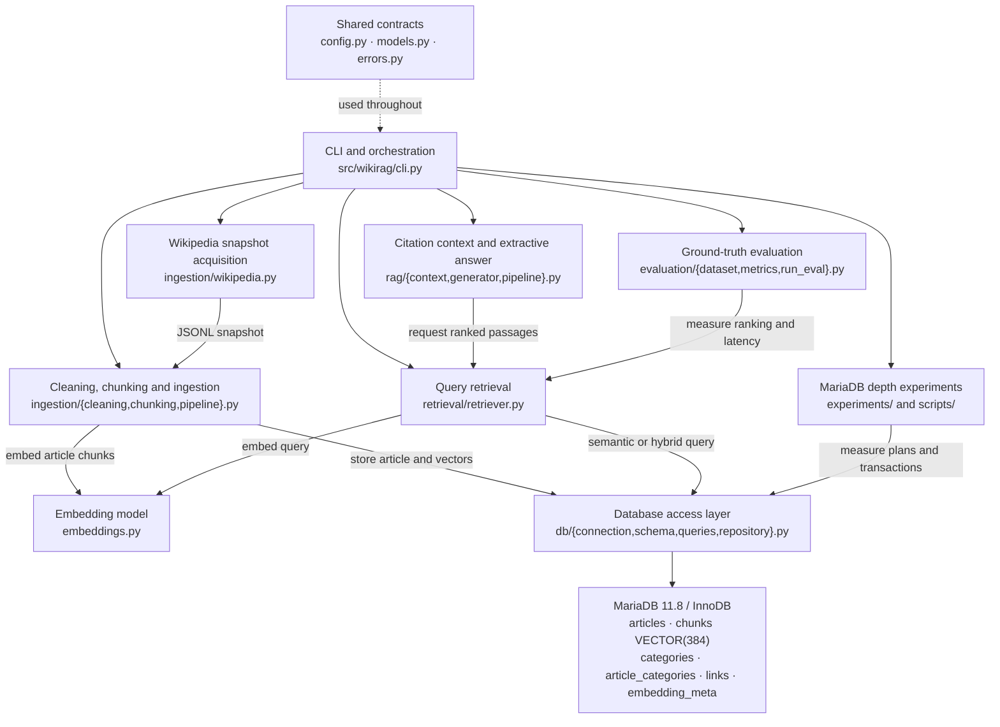
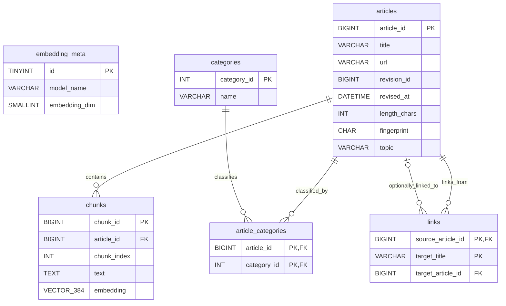
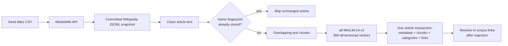
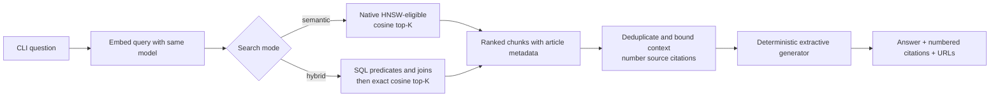

# WikiRAG System Architecture

WikiRAG implements **Area 4 — Vector search and RAG, natively** with MariaDB 11.8. It ingests a fixed corpus of English Wikipedia computer-science articles, stores their metadata and embedding vectors in the **same transactional database**, and exposes semantic search, SQL-filtered hybrid search, and citation-based question answering through a Python CLI.

This document describes the **implemented system**, not every optional component proposed in the team's architecture blueprint. The official assignment defines the hand-in requirements; [`interfaces.md`](interfaces.md) defines the agreed code contracts.

## 1. Module architecture



`cli.py` is the main integration point. The ingestion and retrieval modules share the same embedding interface and database repository contract; neither runs SQL directly. The default RAG generator is **extractive**, not an external LLM. `tests/fakes.py` supplies a deterministic fake embedder and in-memory repository for tests, not for production Wikipedia retrieval.

### Module ownership and responsibilities

| Component | Primary responsibility | Implementation |
| --- | --- | --- |
| Foundation and integration (Tanya) | Settings, shared models, CLI, Docker/Make, database schema, native SQL, transaction safeguards | `config.py`, `models.py`, `cli.py`, `db/`, `Makefile` |
| Wikipedia ingestion (Zineb) | Seed selection, MediaWiki acquisition, JSONL snapshot, text cleaning/chunking, CPU embeddings, idempotent ingestion | `ingestion/`, `embeddings.py`, `data/seed_titles.csv` |
| Retrieval, RAG and evaluation (Marwan) | Query embeddings, ranked retrieval, context/citations, extractive answering, labeled evaluation and metrics | `retrieval/`, `rag/`, `evaluation/` |
| Shared experiments and validation | Index-plan, transaction and cache experiments; unit, integration and end-to-end verification | `experiments/`, `scripts/`, `tests/`, `results/` |

Contributors collaborate on interfaces, documentation, integration reviews, and tests. The authoritative API signatures and error contracts are in [`docs/interfaces.md`](interfaces.md).

## 2. Data model and native-vector storage

The canonical schema is [`sql/001_schema.sql`](../sql/001_schema.sql), created or verified by `db/schema.py`. All six tables use InnoDB.



- **`articles`** stores the canonical page ID, URL, title, revision and fetch timestamps, cleaned length, topic, and fingerprint. Indexed metadata supports normal relational filtering.
- **`chunks`** stores passage text, sequence number, parent article ID, and `VECTOR(384)` together. `VECTOR INDEX (embedding) M=16 DISTANCE=cosine` supplies native HNSW search; the article FK preserves relational ownership.
- **`categories` / `article_categories`** normalize Wikipedia's many-to-many article/category relationship.
- **`links`** records outgoing Wikipedia target titles and resolves targets to an article ID when the target is in the selected corpus. Out-of-corpus links remain unresolved.
- **`embedding_meta`** records the model identifier and vector dimension. Ingestion and retrieval check it to prevent mixing incompatible embeddings.

A single relational database stores both vector-search inputs and the filtering attributes. There is no separate vector service or synchronization pipeline. See [`database.md`](database.md) for the full schema rationale, integrity constraints, index parameters, and detailed repository API.

## 3. Wikipedia ingestion and transaction flow

The committed corpus specification is [`data/seed_titles.csv`](../data/seed_titles.csv). `build-snapshot` obtains article data using the MediaWiki API; the committed [`wikipedia_snapshot.jsonl`](../data/snapshot/wikipedia_snapshot.jsonl) freezes the fetched revisions for repeatable ingestion.



The actual sequence in `ingestion/pipeline.py` is:

1. Validate the stored embedding-model metadata and read one snapshot article.
2. Clean text; compute a SHA-256 fingerprint from the cleaned text, chunking settings, and model identifier.
3. **Check the existing fingerprint before embedding**; unchanged articles are skipped.
4. Split changed text into chunks of at most **1,000 characters** with an intended **150-character overlap**, preferring natural text boundaries.
5. Generate normalized **384-dimensional** vectors using `sentence-transformers/all-MiniLM-L6-v2` on CPU.
6. Call `WikiRepository.ingest_article()` to atomically insert or replace article metadata, vectors, category associations, and outgoing link rows.
7. Continue past reportable per-article failures and call `resolve_links()` **once after processing the snapshot**.

The source snapshot currently yields **200 articles, 8,743 chunks, seven topics, and 1,056 populated categories**. The model is small enough for a local CPU workflow; its vector dimension matches the schema. The chunk length and overlap balance contextual continuity with passage granularity. These are character-based limits, not token-based guarantees.

### Transaction boundaries and idempotency

`db/connection.py::transaction()` commits on success and rolls back on failure. `WikiRepository.ingest_article()` wraps the article, its chunk vectors, categories, and outgoing links in **one transaction**. An unchanged fingerprint returns `skipped`; a changed fingerprint replaces the dependent records atomically. Link target resolution happens in a **separate transaction** after the ingestion loop, once all candidate articles exist.

On article replacement and deletion, the repository explicitly removes indexed child `chunks` rows before the parent article. This mitigates an HNSW visibility regression observed during transaction experiments, while the schema retains foreign-key cascades as an integrity safeguard. This is an observed local mitigation, **not a proven upstream MariaDB fix**. See [`database_experiments.md`](database_experiments.md).

## 4. Semantic search, hybrid search, and RAG



**Semantic mode:** `Retriever.retrieve()` embeds the question and invokes `WikiRepository.search_chunks()` without filters. The HNSW-eligible SQL ranks `chunks.embedding` by `VEC_DISTANCE_COSINE` **before** joining results to article metadata; index selection has been checked with `EXPLAIN`.

**Hybrid mode:** the same repository accepts article ID, excluded ID, topic, category, minimum article length, revision timestamp, outgoing-link, and maximum-distance constraints. `db/queries.py::build_hybrid_search_query()` constructs a parameterized SQL statement joining `chunks` to `articles` and checking relevant category/link tables. Relational constraints are applied **inside MariaDB**, before the final top-K selection.

The current hybrid implementation intentionally uses **exact cosine ranking with `IGNORE INDEX (embedding)`**, rather than asserting HNSW acceleration for filtered searches. This prevents an approximate top-K candidate list from being exhausted by selective filters. The tradeoff is substantially higher latency on broad filters. The system therefore demonstrates **native SQL-plus-vector filtering in one database**, but **does not claim that its filtered path uses the vector index**.

**RAG mode:** `rag/context.py::build_context()` preserves hit order, deduplicates chunk IDs, sets `[1]`, `[2]`, etc., and stops before exceeding the configured character limit. `ExtractiveGenerator` selects sentences from retrieved sources and attaches citations; `answer_question()` verifies citation numbers. If no passages fit or are retrieved, it returns a fixed insufficient-information answer. This default does **not** call a hosted LLM and can produce imperfect prose. See [`retrieval-rag.md`](retrieval-rag.md).

## 5. Evaluation and database-depth experiments

[`data/eval/queries.jsonl`](../data/eval/queries.jsonl) contains **40 reviewed questions** with known relevant **article IDs**: 25 semantic questions and 15 constrained questions. Marwan's benchmark uses the real MiniLM embedder and the populated MariaDB corpus. The evaluation pipeline deduplicates ranked chunks to unique article IDs and reports **MRR, Recall@K, Precision@K, and retrieval latency**. For the 15 constrained questions, it also compares semantic versus hybrid search and independently checks whether returned hits obey SQL filters.

Benchmark methodology: one warm-up request per question/mode, then **five measured repetitions** in the committed final reports; latency p50/p95 are calculated across per-question averages. Retrieval metrics are **not** a claim about generated-answer correctness. Consult [`evaluation.md`](evaluation.md), [`evaluation_semantic.md`](../reports/evaluation_semantic.md), [`evaluation_comparison.md`](../reports/evaluation_comparison.md), and [`evaluation_metadata.json`](../reports/evaluation_metadata.json).

The MariaDB-depth investigations provide separate evidence:

| Experiment | Scope | Main finding / limitation |
| --- | --- | --- |
| Distance expression | Real 8,743-chunk corpus; `EXPLAIN` and repeated timings | Direct cosine ranking used the VECTOR index; Euclidean and wrapped cosine expressions did not in the measured run |
| Transaction visibility | Isolated `wikirag_test`; two isolation levels | Uncommitted vectors remained invisible; committed vectors became visible; regression coverage protects indexed-search behavior |
| HNSW cache size | Separate `wikirag_cache_test`; synthetic 6,000-vector corpus | Five-cycle cache-size comparison probes database behavior; **not** a real-Wikipedia relevance benchmark |

Raw evidence is in [`results/experiments/`](../results/experiments/) and the methodology and caveats are in [`database_experiments.md`](database_experiments.md).

## 6. Reproducibility, isolation, and tests

The standard deployment uses **Python 3.11+**, locked dependencies in `uv.lock`, and Docker Compose's `mariadb:11.8` image; development and reported experiments used MariaDB **11.8.9**. Credentials are loaded from a private `.env` file, not committed source. A normal reader can run:

```bash
cp .env.example .env  # then replace the example passwords
make setup
make demo
```

`make setup` installs the locked packages, waits for MariaDB, verifies or creates the schema, ingests the committed snapshot, creates the dedicated test database, and prints corpus statistics. `make demo` checks the full corpus and exercises statistics, semantic retrieval, hybrid retrieval, and cited RAG without modifying application data. See [`setup.md`](setup.md) and [`README.md`](../README.md) for the complete walkthrough.

Database environments have distinct purposes:

| Database | Purpose | Behavior |
| --- | --- | --- |
| `wikirag` | 200-article application corpus | Normal setup preserves existing data; demo is read-only |
| `wikirag_test` | Database integration and CLI E2E tests | Test fixtures can recreate the test schema; **never run on the application database** |
| `wikirag_cache_test` | Isolated synthetic HNSW cache benchmark | Separate Compose service, port, and persistent volume |

Run `make test` for the full suite, `make test-db` for MariaDB integration tests, and `make lint` for Ruff. GitHub Actions runs unit tests and the `integration or e2e` set against a temporary MariaDB instance. The project has unit, real-DB integration, and CLI-level end-to-end tests; the E2E test uses a deterministic fake embedder and an isolated test database rather than rebuilding the real model.

## 7. Why MariaDB and the main tradeoffs

A separate vector store would require a synchronization strategy for Wikipedia metadata, relational filters, and vector inserts/updates/deletes. Here, `articles`, `categories`, `links`, and vector-indexed `chunks` share **InnoDB transactions, foreign keys, and SQL joins**. The project tests this operational coupling rather than merely claiming it: the hybrid queries combine cosine ranking and predicates in SQL, while the transaction experiment measures whether indexed results track committed state.

The major design choices are deliberate:

- **Committed Wikipedia snapshot:** repeatable input despite later edits on Wikipedia; the seed list also supports regeneration.
- **MiniLM, 384 dimensions:** CPU-compatible local embeddings with matching MariaDB vector dimensionality; exact model compatibility is stored and checked.
- **1,000-character chunks / 150-character overlap:** balance readable passages with context carried across adjacent chunks.
- **Cosine HNSW (`M=16`) for semantic retrieval:** native indexed nearest-neighbor search without a second database.
- **Exact SQL-filtered hybrid retrieval:** prioritize correctness under selective predicates over HNSW latency.
- **Extractive generator:** offline, deterministic demonstration with citations; does not guarantee fluent or fully correct answers.
- **Separate test and cache databases:** destructive test/experiment setup cannot accidentally clear the real Wikipedia corpus when configured as documented.

For the precise shared contracts, schema, corpus handling, retrieval limitations, and experimental evidence, consult [`interfaces.md`](interfaces.md), [`database.md`](database.md), [`ingestion.md`](ingestion.md), [`retrieval-rag.md`](retrieval-rag.md), and [`evaluation.md`](evaluation.md).
